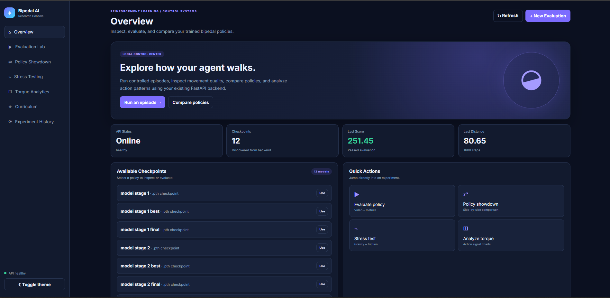
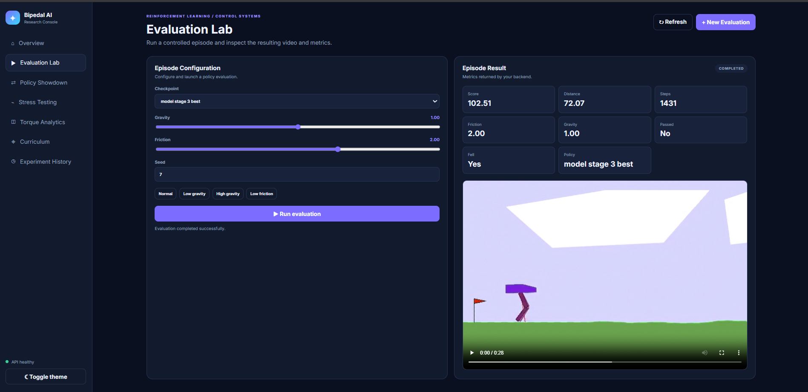
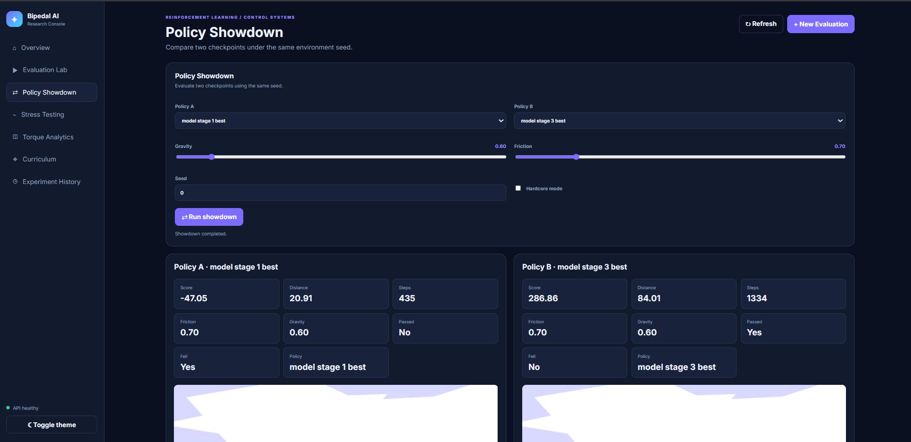
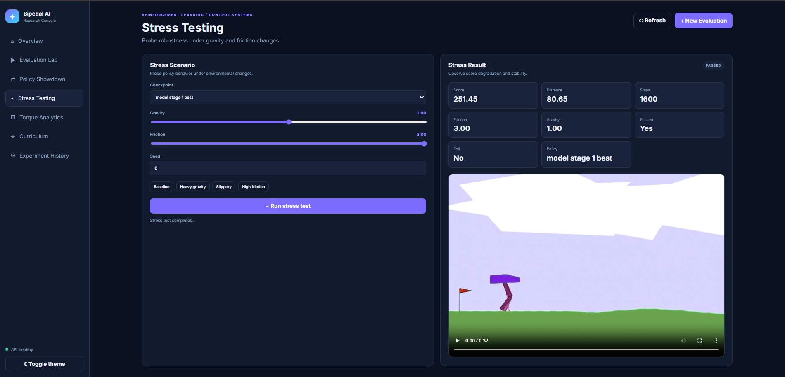
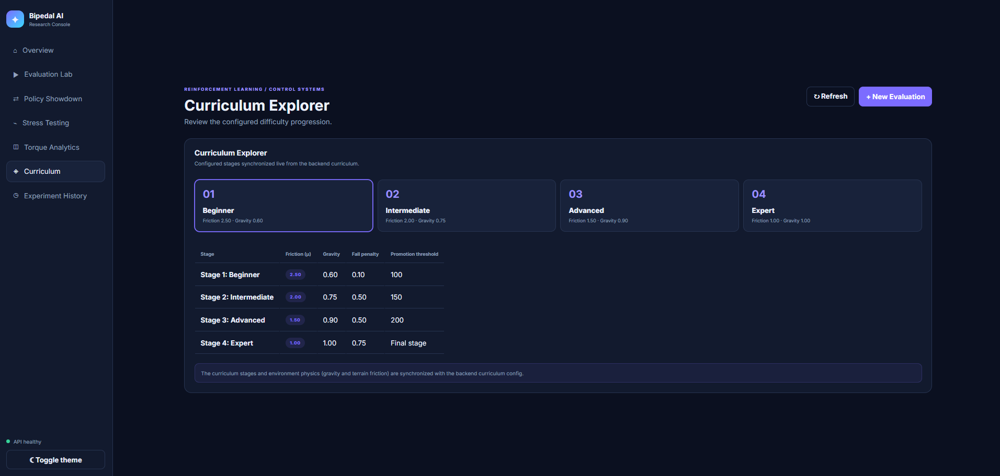
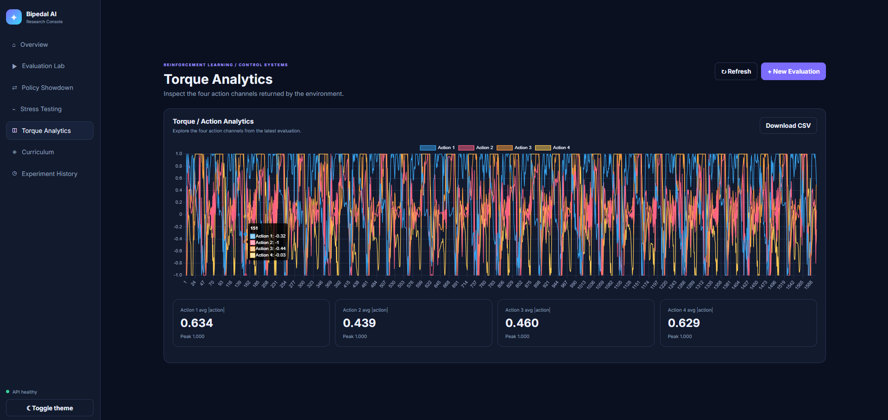
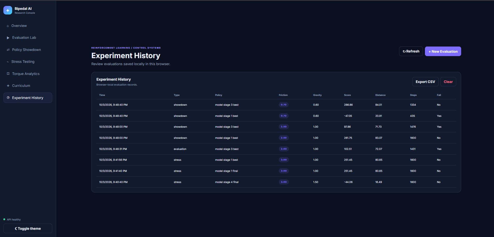

# Bipedal PPO Curriculum

An interactive reinforcement-learning project for training, evaluating, and
comparing PPO agents in Gymnasium's `BipedalWalker-v3` environment.

The project combines a curriculum-based PPO training pipeline with a browser
interface for inspecting checkpoints, running controlled evaluations, comparing
policies, and analyzing their actions.



## What it provides

- **Curriculum training** across four stages that progressively change gravity,
  terrain friction, and fall penalties.
- **PPO actor-critic learning** with observation normalization, generalized
  advantage estimation, clipped policy updates, and gradient clipping.
- **Evaluation Lab** for running a selected checkpoint with configurable
  environment settings.
- **Policy Showdown** for evaluating two checkpoints with the same seed and
  physics configuration.
- **Stress Testing** for probing policy behavior under altered gravity and
  friction.
- **Torque analytics** for visualizing all four action channels and exporting
  action data as CSV.
- **Experiment History** stored locally in the browser, with CSV export.

## Interface

| Evaluation Lab | Policy Showdown |
| --- | --- |
|  |  |

| Stress Testing | Curriculum Explorer |
| --- | --- |
|  |  |

| Torque Analytics | Experiment History |
| --- | --- |
|  |  |

## Project structure

```text
.
├── assets/                 
├── backend/
│   ├── api/server.py       # FastAPI endpoints and recorded-video serving
│   ├── env/wrappers.py     # BipedalWalker environment configuration
│   ├── models/             # Actor-critic model and checkpoint utilities
│   ├── training/           # PPO engine, curriculum, and training loop
│   ├── main.py             # Training and serving CLI
│   └── pyproject.toml      
└── frontend/
    ├── index.html          
    ├── app.js              
    └── styles.css          
```

## Requirements

- Python 3.11 or newer
- [`uv`](https://docs.astral.sh/uv/)
- A browser with JavaScript enabled

## Setup and run

Install the backend dependencies:

```powershell
cd backend
uv init
uv sync
```

Start the application server:

```powershell
uv run python main.py serve
```

Open [http://127.0.0.1:8000](http://127.0.0.1:8000) in a browser. The backend
serves the frontend at the root URL, so a separate frontend development server
is not required for normal use.

FastAPI's interactive API documentation is available at
[http://127.0.0.1:8000/docs](http://127.0.0.1:8000/docs).

## Train a policy

Run training from `backend\`:

```powershell
uv run python main.py train
```

The default run uses 1,000,000 environment steps and a learning rate of
`3e-4`. Override either value when needed:

```powershell
uv run python main.py train --total-steps 300000 --learning-rate 0.0003
```

Training promotes the agent when the average of the latest 100 episode scores
reaches the active stage's threshold. The configured stages are:

| Stage | Gravity | Friction | Fall penalty | Promotion score |
| --- | ---: | ---: | ---: | ---: |
| Beginner | 0.60 | 2.50 | 0.10 | 100 |
| Intermediate | 0.75 | 2.00 | 0.50 | 150 |
| Advanced | 0.90 | 1.50 | 0.50 | 200 |
| Expert | 1.00 | 1.00 | 0.75 | — |

## Documentation

For backend-specific implementation details and commands, see
[backend/README.md](backend/README.md).